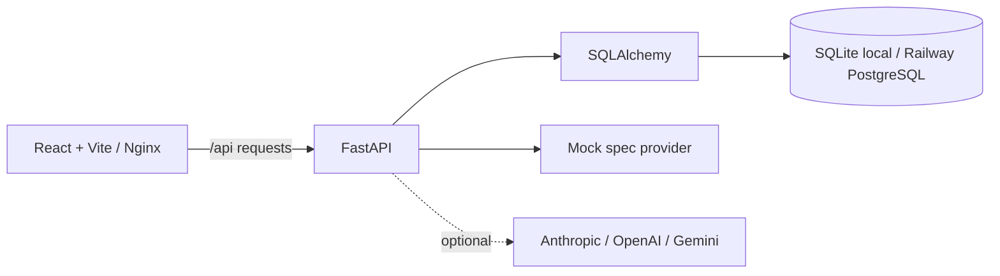

# Architecture

PropLoop is a small monorepo with a React single-page client, FastAPI application, and SQLAlchemy persistence. Local development uses SQLite by default; Railway uses PostgreSQL through `DATABASE_URL`. The backend normalizes Railway `postgres://` and `postgresql://` URLs to the psycopg v3 SQLAlchemy driver.

## Ownership boundaries

- `backend/app/api/routes/core.py`: HTTP contract, validation, and lifecycle gates.
- `backend/app/models.py`: persistence entities and relationships.
- `backend/app/spec_generator.py`: provider selection and AI-generated drafts.
- `backend/app/measurement.py`: before/after comparison and approximate confidence.
- `backend/app/quality.py`: review and release artifact generation.
- `frontend/src/api/client.js`: API transport.
- `frontend/src/App.jsx`: overview, detail, review, measurement, and quality views.

## Data flow

A spec is stored as versionable JSON on the experiment. Once approved, its checklist is materialized as implementation task rows. Metrics and decision records are append-only records associated with an experiment. Opaque participant keys are deterministically assigned to control or treatment and never need to contain resident identifiers. Approval flags and stage transitions are server-controlled; the client cannot bypass the release gate. Quality artifacts and measured CI snapshots are stored as JSON records.

## Deployment

Railway project resources are described in `.railway/railway.ts` using the current project-level IaC SDK. It declares backend and frontend services plus managed PostgreSQL; each service reads its Dockerfile from its monorepo root directory, and the frontend Nginx proxy uses the backend private domain. Planning/applying requires a pushed GitHub repository, `PROPLOOP_GITHUB_REPOSITORY`, and a linked Railway project. This workspace has not been linked or deployed. The backend applies Alembic migrations before startup.

The optional GitHub Actions quality upload uses JUnit and coverage reports from CI. It requires a backend `QUALITY_INGEST_TOKEN` and matching repository secrets. Manual quality inputs remain available for reviewed values outside CI.
