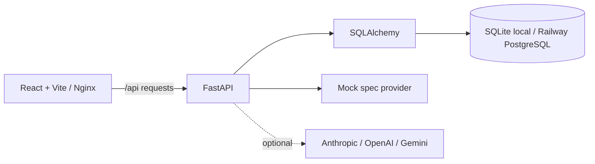

# Architecture

PropLoop is a small monorepo with a React single-page client, FastAPI application, and SQLAlchemy persistence. Local development uses SQLite by default; Railway uses PostgreSQL through `DATABASE_URL`. The backend normalizes Railway `postgres://` and `postgresql://` URLs to the psycopg v3 SQLAlchemy driver.

## Ownership boundaries

- `backend/app/api/routes/core.py`: HTTP contract, validation, and lifecycle gates.
- `backend/app/models.py`: persistence entities and relationships.
- `backend/app/spec_generator.py`: provider selection and AI-generated drafts.
- `backend/app/measurement.py`: descriptive before/after comparison.
- `backend/app/outcomes.py`: observed-participant metrics and Fisher/Welch inference.
- `backend/app/auth.py`: invite-only accounts, cookie sessions, CSRF, and role checks.
- `backend/app/lifecycle.py`: stage guards and named approval audit.
- `backend/app/quality.py`: review and release artifact generation.
- `frontend/src/api/client.js`: API transport.
- `frontend/src/App.jsx`: overview, detail, review, measurement, and quality views.

## Data flow

A spec is stored as versionable JSON on the experiment. Once approved, its checklist is materialized as implementation task rows. Metrics and decision records are append-only records associated with an experiment. Opaque participant keys are deterministically assigned to control or treatment and never need to contain resident identifiers. Approval flags and stage transitions are server-controlled; the client cannot bypass the release gate. Quality artifacts and measured CI snapshots are stored as JSON records.

## Deployment

Railway project resources are described in `.railway/railway.ts` using the current project-level IaC SDK. It declares backend and frontend services plus managed PostgreSQL; each service reads its Dockerfile from its monorepo root directory, and the frontend Nginx proxy uses the backend private domain. Planning/applying requires a pushed GitHub repository, `PROPLOOP_GITHUB_REPOSITORY`, and a linked Railway project. The backend applies Alembic migrations before startup. Alembic renders the connection URL with its password intact and escapes percent signs for its configuration parser; SQLAlchemy's default string representation masks passwords and must not be used to construct a connection URL. Credentials must never be logged.

Production requires `COOKIE_SECURE=true`, the exact public frontend origin in `FRONTEND_URL`, and an operator-provided `BOOTSTRAP_TOKEN` for first-admin setup. Without the bootstrap token, public account claiming is disabled. Invite-only setup and roles are documented in [access control](access_control.md). The same-origin Nginx proxy carries HttpOnly session cookies; CSRF tokens are held in memory, not browser persistent storage.

Hosted provider responses must satisfy the complete nested experiment-spec schema. Missing keys, network errors, and malformed drafts fail explicitly without replacing the existing draft or silently switching providers. Mock is the default; hosted-provider integration tests use stubbed responses unless operator credentials are configured.

The optional GitHub Actions quality upload uses JUnit, coverage, and lint reports from CI. It requires a backend `QUALITY_INGEST_TOKEN` and matching repository secrets, plus a selected experiment ID on workflow dispatch. Manual quality inputs remain available for reviewed values outside CI.

The original proposed file tree is implemented with consolidated routes and models, rather than many single-purpose wrappers. Account, board, outcome-capture, and team-management UI components are separated; equivalent lifecycle behavior is server-enforced regardless of client layout.
